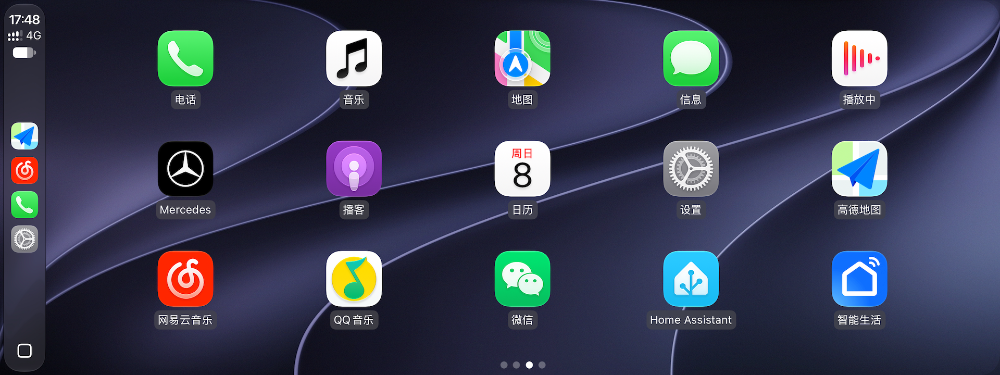
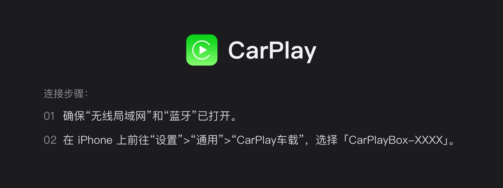
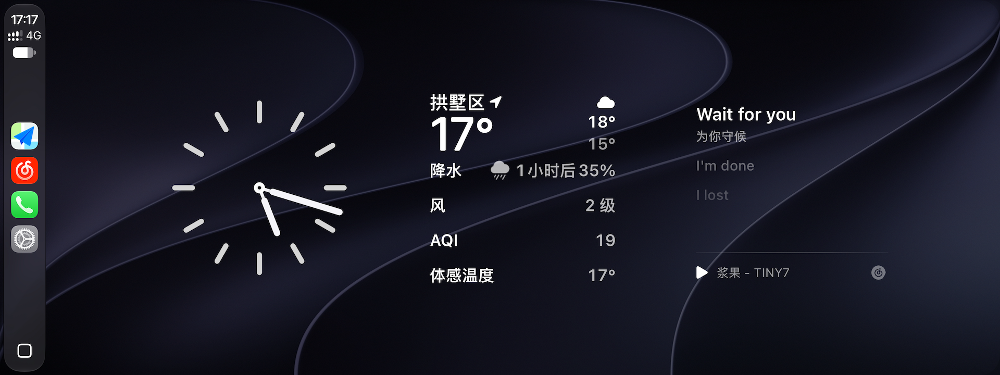
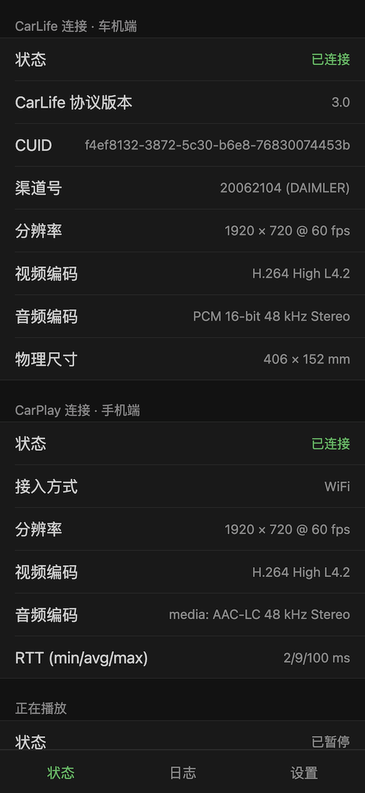
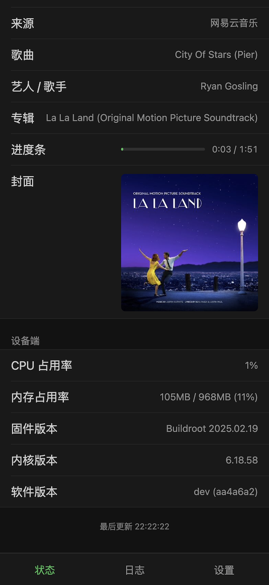

# cp2cl

[](LICENSE) [](https://github.com/0x5e/cp2cl/actions/workflows/build.yml) [](https://github.com/0x5e/cp2cl/releases/latest) 

CarPlay to CarLife. 让 iPhone CarPlay 能够连接到 CarLife 车机。运行于 Linux 嵌入式设备。



## 背景

本项目主要用于**奔驰 MBUX NTG6 车机**，通过转接 CarLife 通道实现 CarPlay 的全屏显示。其他车机未经测试。

> NTG6 的 CarLife 窗口能全屏显示，而 CarPlay 窗口只能显示一半。

## 特性

- 支持有线、无线 CarPlay
- 视频流纯转发，无编解码环节，低性能开销
- 支持所有音频流：媒体、导航、通话（双向）、Siri（双向）
- 支持智能缩放显示，开启后可显示3个小组件
- 支持仪表盘媒体信息显示（含封面）
- 适配车机图标与名称
- 后台管理页，可查看状态、日志、设置

## 硬件适配列表

固件基于 Buildroot 2025.02 构建，开机启动时间相对 Ubuntu 从 30s 提升到 8s。

- [x] OrangePi-Zero2W
- [x] 随身WiFi-UFI001C（很卡，不推荐）
- [x] NanoPi-Duo2（略卡，不推荐）

其他适合的设备参考：[DashPlay - 硬件](https://github.com/yizhixiaoheigou/DashPlay/blob/main/README.md#硬件)
后续有时间我会尝试适配，欢迎小伙伴帮忙一起测试。

## 运行环境

### 硬件要求

- 1个 USB OTG 口
- 1个 USB Host 口（可选，用于有线 CarPlay）
- WiFi + BLE 网卡（可选，用于无线 CarPlay）
- 存储空间大于 128MB

## 使用方式
### 使用固件
[Github Release](https://github.com/0x5e/cp2cl/releases)可下载对应固件或可执行文件。

### 使用安装包（暂无）
Ubuntu、Debian、OpenWrt 安装包暂未提供。
[Github Release](https://github.com/0x5e/cp2cl/releases)可下载 armv7、aarch64 可执行文件，需要自行准备启动脚本，安装相关依赖。

依赖列表（待补充）：
dbus, bluez, hostapd, dnsmasq-base, iw, kmod

## 运行截图





<p align="left">
  
  
</p>

## 性能数据

### 测试环境
手机：iPhone 15 Pro，iOS 27.2
盒子：OrangePi Zero 2W，Buildroot 2015.02，cp2cl v0.16.3
车机：Mac mini M4，CarLifePort
视频参数：1920x720@60

### 无线 CarPlay 启动时间

在已配对的情况下，从上电到首帧渲染，提取各个阶段的内核时间，测试10次数据如下。

#### 手机亮屏状态
| 程序启动 | 引导页显示 | 蓝牙已连接 | CarPlay 已连接 | 首帧渲染 |
| ---- | ---- | ---- | ---- | ---- |
| 8.39 | 10.88 | 31.40 | 31.99 | 32.90 |
| 8.32 | 11.04 | 20.35 | 28.19 | 28.93 |
| 8.31 | 11.09 | 26.52 | 26.87 | 27.40 |
| 8.33 | 10.98 | 20.58 | 28.08 | 28.73 |
| 8.19 | 11.20 | 19.78 | 23.27 | 24.01 |
| 8.49 | 11.08 | 21.79 | 25.32 | 26.15 |
| 8.32 | 11.14 | 24.60 | 30.87 | 31.73 |
| 8.21 | 10.98 | 43.73 | 44.45 | 45.12 |
| 8.50 | 11.25 | 28.48 | 29.06 | 29.72 |
| 8.21 | 11.10 | 19.57 | 23.01 | 23.63 |

| 阶段 | 最小值 | 平均值 | 最大值 |
| ---- | ---- | ---- | ---- |
| 程序启动 | 8.19 | 8.33 | 8.50 |
| 引导页显示 | 10.88 | 11.07 | 11.25 |
| 蓝牙已连接 | 19.57 | 25.68 | 43.73 |
| CarPlay 已连接 | 23.01 | 29.11 | 44.45 |
| 首帧渲染 | 23.63 | 29.83 | 45.12 |

#### 手机熄屏状态
| 程序启动 | 引导页显示 | 蓝牙已连接 | CarPlay 已连接 | 首帧渲染 |
| ---- | ---- | ---- | ---- | ---- |
| 8.48 | 11.27 | 51.33 | 51.79 | 52.36 |
| 8.49 | 11.26 | 56.44 | 57.00 | 57.58 |
| 8.24 | 11.21 | 52.36 | 52.95 | 53.72 |
| 8.41 | 10.98 | 31.74 | 33.23 | 33.79 |
| 8.21 | 10.93 | 43.23 | 43.73 | 44.34 |
| 8.31 | 11.19 | 52.27 | 52.67 | 53.37 |
| 8.46 | 10.88 | 31.81 | 32.88 | 33.54 |
| 8.30 | 10.93 | 30.89 | 31.28 | 32.20 |
| 8.39 | 10.93 | 22.27 | 23.70 | 24.37 |
| 8.33 | 11.19 | 22.71 | 24.36 | 25.05 |

| 阶段 | 最小值 | 平均值 | 最大值 |
| ---- | ---- | ---- | ---- |
| 程序启动 | 8.21 | 8.36 | 8.49 |
| 引导页显示 | 10.88 | 11.08 | 11.27 |
| 蓝牙已连接 | 22.27 | 39.51 | 56.44 |
| CarPlay 已连接 | 23.70 | 40.36 | 57.00 |
| 首帧渲染 | 24.37 | 41.03 | 57.58 |

亮屏状态下，平均30s以内完成从上电到首帧渲染的整个过程，熄屏状态平均40s左右。
主要耗时在蓝牙连接这一步，反复超时/失败/重试导致整体时间变长，后续还会继续定位和优化。

### 延迟表现
TODO

## 开发调试

### 编译
在项目根目录运行：

```shell
# 可从 com.baidu.carlife_8.9.0_base.apk/classes2.dex 中获取。
# com/baidu/carlife/authorization/PrivateKeyManager.java:37
export CARLIFE_PRIVATE_KEY="MIICdwIBAD..........gHdvNpcqA="
make all
```
应用和固件产物位于`dist/`目录.

### 调试工具

CarLife 车机端 - macOS 版：[CarLifePort](https://github.com/0x5e/CarLifePort)

## 配置

配置文件目录位于`/etc/cp2cl/`，配置文件`config.json`及MFi证书、私钥均置于此目录

| 字段名 | 默认值 | 备注 |
|---|---|---|
| `log_level` | `debug` | 日志级别：`error`, `warn`, `info`, `debug` |
| `wifi_iface` | `wlan0` | Wi-Fi接口名称 |
| `bt_adapter` | `hci0` | 蓝牙适配器名称 |
| `addr` | `0.0.0.0:80` | Web后台监听地址与端口 |
| `screen` | — | 屏幕自定义参数：`width`, `height`, `fps` |

例子：
```json
{
  "log_level": "debug",
  "wifi_iface": "wlan0",
  "bt_adapter": "hci0",
  "addr": "0.0.0.0:80",
  "screen": { "width": 1920, "height": 720, "fps": 60 }
}
```

MFi证书（`certificate.p7b`）、密钥（`identity.pk8`）文件可以在构建前放置于项目`authentication/`目录下，或是运行前拷贝至配置文件目录。

## 已知问题
- 初次无线 CarPlay 配对可能会超时（约15秒），也可能会失败多次，原因暂不明。
- 方向盘右侧方向键无法完整支持。无论按上下还是左右，MBUX NTG6 车机都只会发送`KEYCODE_SELECTOR_NEXT`/`KEYCODE_SELECTOR_PREVIOUS`，无法辨别，只能按照滚轮“前/后”进行映射。
- 受 CarLife 协议限制，无法根据车外环境光自动变化 CarPlay 浅色、深色模式。你可以在「CarPlay 设置页 - 外观」手动进行切换。

## 来源与许可
参考项目：
- [LIVI](https://github.com/f-io/LIVI)
- [MacPlay](https://github.com/Roylyl/MacPlay)
- [playport](https://github.com/youcci/playport)

项目沿用 GPL-3.0-or-later。
